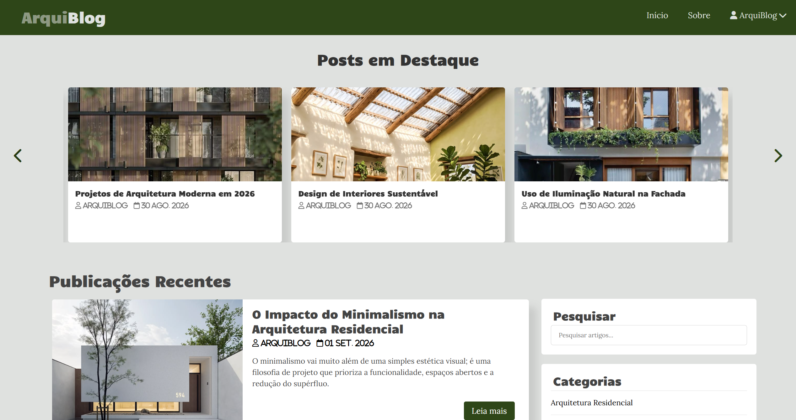

# ArquiBlog

Projeto de um blog responsivo focado no universo da **Arquitetura, Design de Interiores e Urbanismo**, desenvolvido como atividade prática para o estudo e aplicação de conceitos fundamentais do desenvolvimento web front-end.

A página apresenta um carrossel de posts em destaque, uma seção para artigos recentes, barra lateral interativa (com pesquisa e categorias) e um rodapé informativo.

# 📸 Print da página

<h3 text-align="center">
    
    <br><br>
    <b>Página de blog responsiva desenvolvida com HTML, CSS, JavaScript, jQuery e Slick JS.</b>
    <br><br>
</h3>

## Índice

- [Sobre](#sobre)
- [Funcionalidades](#funcionalidades)
- [Tecnologias Utilizadas](#tecnologias-utilizadas)
- [Como Usar](#como-usar)

<br>

<a id="sobre"></a>

## Sobre

O **ArquiBlog** é um projeto de página inicial para um blog moderno e intuitivo. Ele foi construído com foco na experiência do usuário, oferecendo navegação clara em qualquer tamanho de tela (desktops, tablets e smartphones).

O projeto foi criado com o intuito de aplicar conceitos práticos de estilização avançada com **CSS**, manipulação de elementos do DOM com **JavaScript**, além da integração de bibliotecas externas como **jQuery** e o plugin de carrossel **Slick JS**.

<br>

<a id="funcionalidades"></a>

## Funcionalidades

- **Layout Totalmente Responsivo:** adaptação dinâmica para telas mobile e desktop;
- **Menu Mobile Interativo:** barra de navegação estilo "hambúrguer" para telas menores;
- **Carrossel de Destaques:** navegação horizontal dinâmica por artigos usando a biblioteca Slick JS;
- **Barra Lateral (Sidebar):** campo de busca e lista de categorias de conteúdos;
- **Rodapé Completo:** informações institucionais, links rápidos, redes sociais e formulário para contato.

<br>

<a id="tecnologias-utilizadas"></a>

## Tecnologias Utilizadas

O projeto foi desenvolvido utilizando:

- **HTML5** — estrutura semântica da página;
- **CSS3** — estilização, esquema de cores, layout flexível e regras de media queries para responsividade;
- **JavaScript (ES6+)** — lógica para alternar a exibição do menu mobile;
- **jQuery** — biblioteca JavaScript utilizada para suporte às funcionalidades do carrossel;
- **Slick Carousel** — plugin JS para criação e controle de slides responsivos;
- **FontAwesome** — biblioteca de ícones vetoriais.

<br>

<a id="como-usar"></a>

## Como Usar

Para visualizar o projeto localmente:

1. Baixe ou clone este repositório:
   ```bash
   git clone https://github.com/aliciaeko/arquiblog.git
   ```
2. Abra a pasta do projeto;
3. Certifique-se de que as imagens do projeto estejam salvas na pasta `img/`;
4. Abra o arquivo `index.html` em qualquer navegador web.

Também é possível utilizar o **Visual Studio Code** com a extensão **Live Server** para visualizar as alterações em tempo real durante o desenvolvimento.

<br>

<h4 text-align="center">
    Feito com 💚 por <a href="https://github.com/aliciaeko" target="_blank">Alícia Eko</a>
</h4>